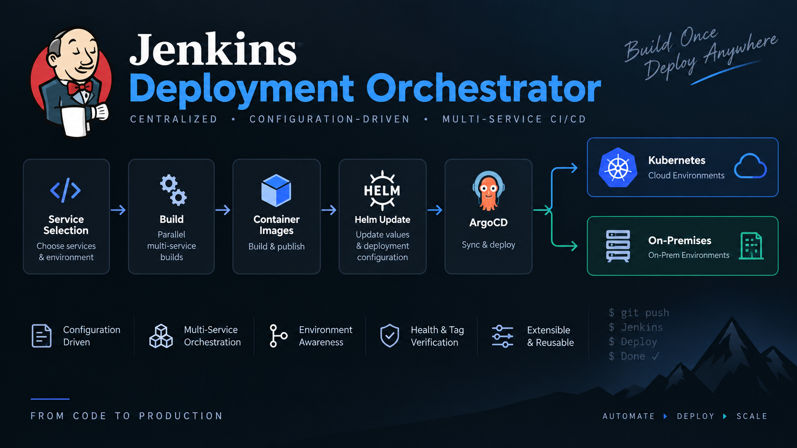
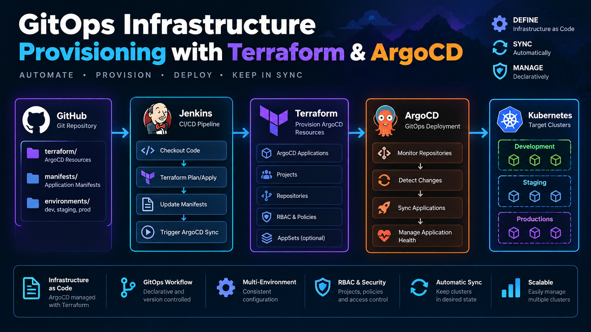
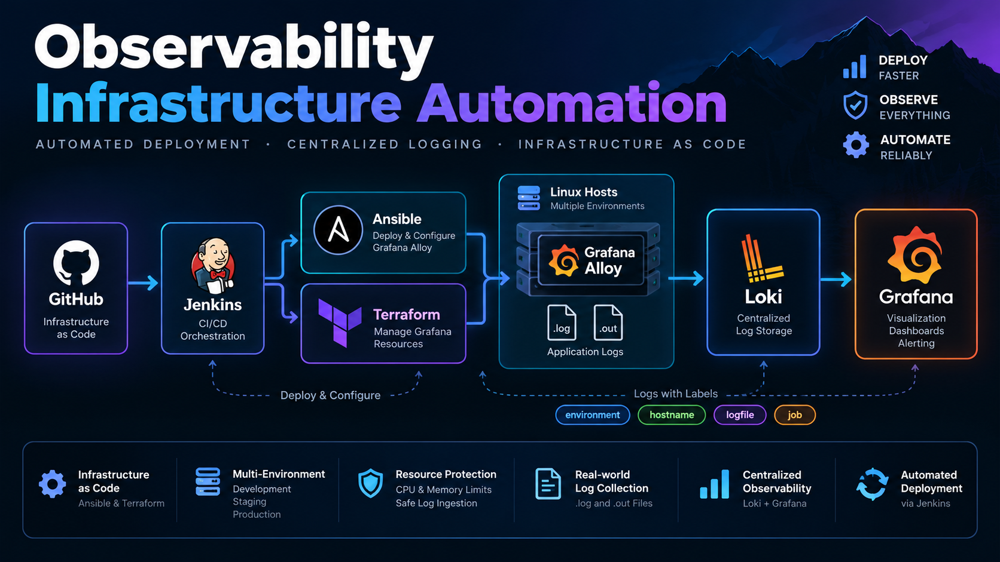
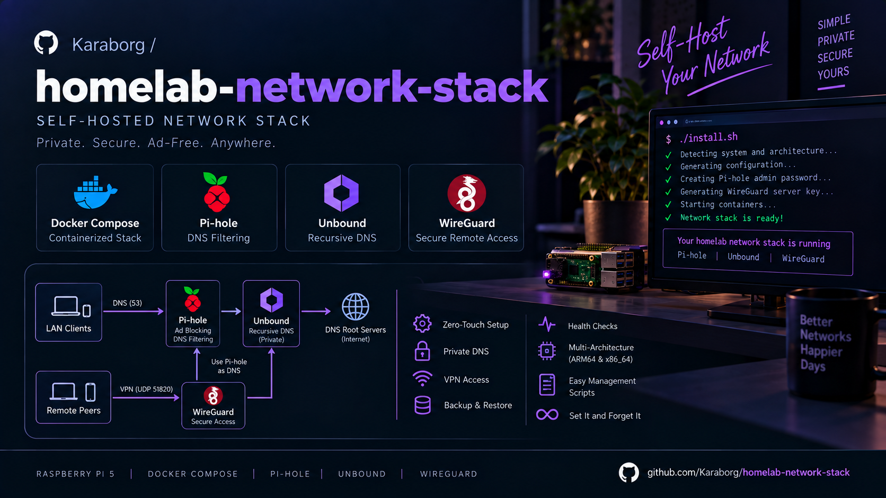

**Building reliable infrastructure, automated delivery pipelines, and observable systems.**

---

### `$ whoami`

I'm a DevOps engineer working across **CI/CD, GitOps, Linux infrastructure, Kubernetes/OpenShift, and observability**. I enjoy turning repetitive operational work into reliable, repeatable automation and solving production problems across application and infrastructure layers.

## ⚡ Core Engineering Stack

### CI/CD & GitOps

### Infrastructure & Containers

### Observability

### Platform & Middleware

### Scripting & Configuration

<h2>🚀 Featured Projects</h2>

<table>
  <tr>
    <td width="50%" align="center">
      
      <h3>Jenkins Deployment Orchestrator</h3>
      
A configuration-driven CI/CD workflow for reliably deploying multiple services across cloud and on-premises environments.

      
Jenkins • Helm • ArgoCD • Kubernetes

    </td>
    <td width="50%" align="center">
      
      <h3>Terraform ArgoCD Provisioning</h3>
      
Repeatable infrastructure and GitOps provisioning that turns cluster setup into a version-controlled, automated workflow.

      
Terraform • Jenkins • ArgoCD • GitOps

    </td>
  </tr>
  <tr>
    <td width="50%" align="center">
      
      <h3>Observability Infrastructure Automation</h3>
      
Automated observability foundations for collecting, correlating, and exploring metrics, logs, and traces across infrastructure.

      
Ansible • Terraform • Grafana Alloy • Loki

    </td>
    <td width="50%" align="center">
      
      <h3>Homelab Network Stack</h3>
      
A self-hosted network stack that delivers private DNS, ad blocking, and secure remote access through reproducible containers.

      
Docker Compose • Pi-hole • Unbound • WireGuard

    </td>
  </tr>
</table>

## 💻 Languages & Technologies

